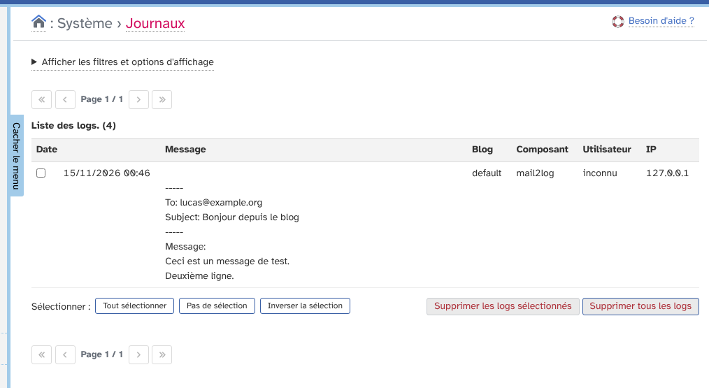

# mail2log : guide d'utilisation

mail2log remplace l'envoi des mails de Dotclear : au lieu d'être envoyés, les mails sont enregistrés dans le journal de Dotclear. C'est un outil pour le développement et les tests.

**Attention : tant que ce plugin est activé, plus aucun mail ne part depuis l'administration.** Ne l'utilisez pas sur un blog en production.

## Table des matières

1. [Prérequis](#prérequis)
2. [Utilisation](#utilisation)
3. [Lire les mails](#lire-les-mails)
4. [Désinstaller](#désinstaller)
5. [Bon à savoir](#bon-à-savoir)

## Prérequis

Pour lire les mails enregistrés, il faut un plugin qui affiche le journal de Dotclear, comme dcLog. Le plugin mail2log n'a lui-même ni réglage, ni page d'administration.

## Utilisation

Installez et activez le plugin : il n'y a rien d'autre à faire. Dès l'activation, les mails que Dotclear envoie depuis l'administration sont stockés dans le journal au lieu d'être envoyés. Cela permet de vérifier le contenu d'un mail sans serveur de messagerie. Le plugin testMail permet par exemple d'envoyer un mail de test.

## Lire les mails

Ouvrez **Système → Journaux**. Chaque mail est une ligne dont le composant est « mail2log ». Le message contient les en-têtes du mail, le destinataire (« To »), le sujet (« Subject ») et le texte.

Utilisez les cases et les boutons « Supprimer les logs sélectionnés » ou « Supprimer tous les logs » pour faire le ménage.

## Désinstaller

Dans la liste des plugins, le bouton « Désinstaller » propose de supprimer les mails enregistrés ainsi que les données du plugin. Désactiver ou supprimer le plugin suffit à rétablir l'envoi normal des mails.

## Bon à savoir

* Seuls les mails envoyés depuis l'administration sont interceptés. Le mail de récupération de mot de passe demandé depuis la page de connexion de l'administration est, lui, bien envoyé et n'est pas enregistré.
* La colonne « Utilisateur » du journal affiche « inconnu » pour ces mails.
* Les mails sont enregistrés sous forme de texte brut : les pièces jointes et les mails HTML ne sont pas décodés.
